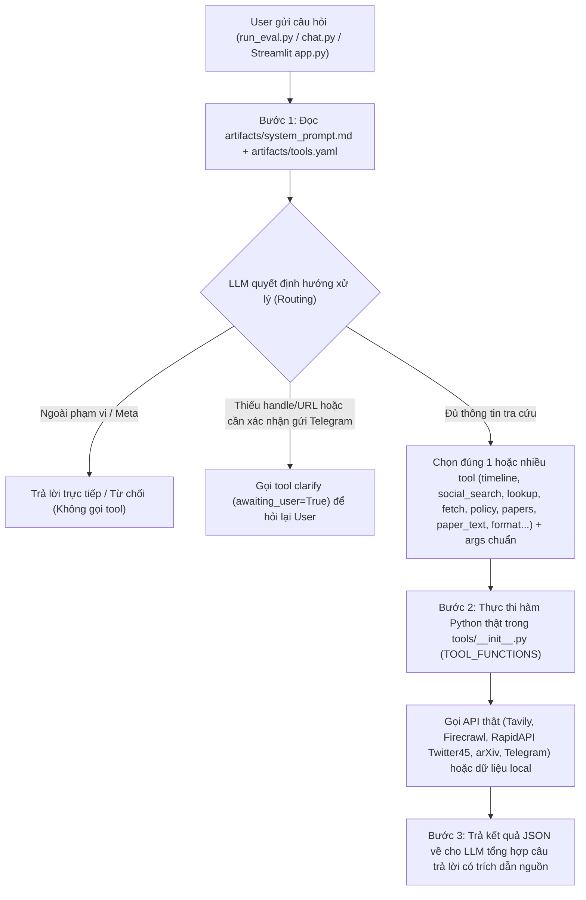
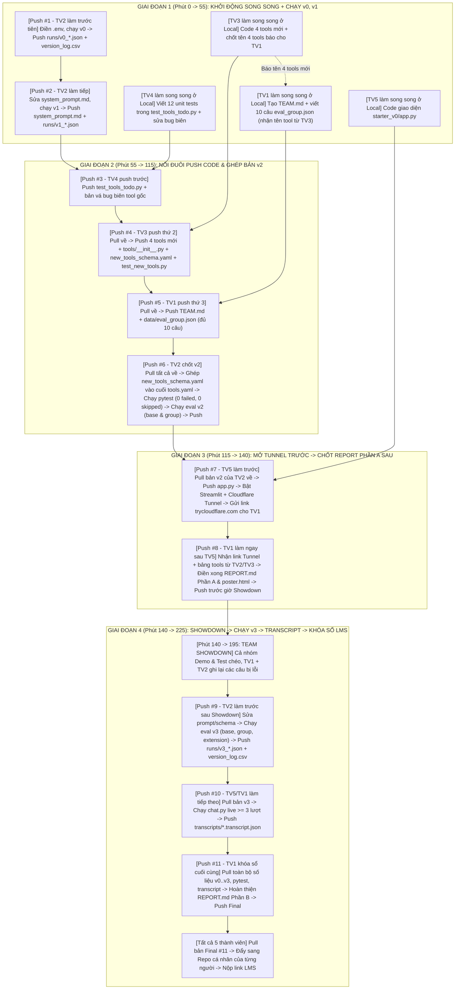

# CẨM NANG LUỒNG LÀM VIỆC & PHỐI HỢP NHÓM 5 NGƯỜI (ZERO-CONFLICT)

> **Chương trình:** VINUNI AI THỰC CHIẾN · COHORT 5 · DAY 03 LAB V2  
> **Đề tài:** Prompt, Function Calling & Tool Design (MCP) — Research Agent Tool Eval  
> **Cấu hình đội hình:** 5 thành viên (1 Low-code + 4 Coders)  
> **Mục tiêu:** Đạt 100% yêu cầu bắt buộc + Trọn vẹn **Điểm Thưởng (Bonus Point)** (*Streamlit UI + 4 Tools mới + 0 failed/0 skipped pytest*) mà **KHÔNG BỊ XUNG ĐỘT CODE (0 Merge Conflict)**.

---

## 1. BỐN QUY ĐỊNH BẮT BUỘC PHẢI NHỚ (THEO SLIDE HƯỚNG DẪN)

| Hạng mục | Quy định bắt buộc | Lưu ý quan trọng cho các thành viên |
| :--- | :--- | :--- |
| **1. Hình thức làm bài** | **BÀI NHÓM (5 thành viên)** | Làm chung 1 sản phẩm nhưng **MỖI HỌC VIÊN VẪN PHẢI TỰ NỘP REPO RIÊNG** lên LMS. Bắt buộc tạo file `TEAM.md` liệt kê đầy đủ thành viên. |
| **2. Đặt tên Repo** | • **Cá nhân:** `K5-L3-DAY03-HoVaTen-MSSV-ResearchAgentToolEval`<br>• **Nhóm:** `K5-L3-DAY03-TenNhom-ResearchAgentToolEval` | Viết liền không dấu, nối bằng dấu gạch ngang (`-`). Ví dụ: `K5-L3-DAY03-PhamVietHung-2A202603370-ResearchAgentToolEval` |
| **3. Hạn chót (Deadline)** | • **Ca sáng (9h–13h) & Ca chiều (14h–18h):** `23:59` hôm nay<br>• **Ca tối (16h30–20h):** `12:00` trưa mai | Riêng `REPORT.md` Phần A + Link Demo bắt buộc xong trước giờ **Team Showdown**. Nộp muộn trên LMS bị trừ điểm. |
| **4. Bảo mật & Nộp bài** | Nộp link repo tại: https://aithucchien.vinuni.edu.vn | **TUYỆT ĐỐI KHÔNG** commit file `.env` và API keys lên GitHub. Chỉ cần 1 máy chính (TV2) có đủ API key để chạy eval. |

---

## 2. LUỒNG HOẠT ĐỘNG ĐƠN GIẢN CỦA RESEARCH AGENT & VÒNG LẶT ĐÁNH GIÁ

Research Agent không tự bịa câu trả lời mà hoạt động theo quy trình điều phối công cụ (**Function Calling / Tool Routing**) gồm 3 bước:



- **Bước 1 — Đọc hướng dẫn & Chọn Tool (Routing):** LLM nhận câu hỏi của user, đối chiếu với luật trong `starter_v0/artifacts/system_prompt.md` và danh sách công cụ trong `starter_v0/artifacts/tools.yaml` để quyết định:
  1. Trả lời trực tiếp / Từ chối nếu ngoài phạm vi;
  2. Gọi tool `clarify` để hỏi lại user nếu thiếu URL/tài khoản hoặc cần xác nhận trước khi gửi Telegram;
  3. Chọn đúng 1 hoặc nhiều tool tra cứu (`timeline`, `social_search`, `lookup`, `fetch`, `policy`, `papers`, `paper_text`, `format`...) kèm tham số (`args`) chuẩn xác.
- **Bước 2 — Thực thi hàm Python thật (Tool Execution):** Hệ thống lấy tên tool và `args` từ LLM để gọi hàm Python tương ứng trong `starter_v0/tools/__init__.py` (`TOOL_FUNCTIONS`), kết nối API thật (Tavily, Firecrawl, RapidAPI Twitter45, arXiv, Telegram) hoặc đọc dữ liệu local.
- **Bước 3 — Tổng hợp kết quả & Phản hồi (Multi-round Loop trong `chat.py` / `app.py`):** Kết quả JSON từ tool được gửi lại cho LLM để tổng hợp thành câu trả lời có trích dẫn nguồn, hoặc dừng chờ người dùng nếu tool trả về cờ `awaiting_user=True`.

### Sự khác biệt giữa 3 chế độ chạy trong Project:
- **`run_eval.py` (Đo Model):** Chạy 1 lượt (one-shot) qua `agent.py` để chấm điểm xem LLM có chọn đúng tool và truyền đúng `args` như đáp án trong `data/eval_base.json` hay không. Xuất bằng chứng ra `runs/*.json`.
- **`pytest` (Đo Code của Tool):** Chạy hoàn toàn offline (mock mạng bằng `fake_http`) để kiểm tra xem code Python của các tool trong thư mục `tools/` có đúng hợp đồng (`test_tool_contract.py`) và xử lý đúng dữ liệu/lỗi hay không (`test_tools_todo.py`, `test_new_tools.py`).
- **`chat.py` & `app.py` (Chạy Tương tác Live):** Chạy hội thoại nhiều vòng thực tế với người dùng và tự động lưu toàn bộ lịch sử vào `transcripts/*.transcript.json`.

---

## 3. PHÂN CÔNG NHIỆM VỤ CHI TIẾT CHO 5 THÀNH VIÊN (1 LOW-CODE + 4 CODERS)

**Mục tiêu của nhóm:** Đạt 100% yêu cầu bắt buộc VÀ lấy trọn **Điểm Thưởng (Bonus Point)** bằng cách:
1. Có giao diện Web UI Streamlit (`starter_v0/app.py`)
2. Tự viết thêm **4 tools mới** (`> 3 tools`)
3. Xanh 100% `pytest` (`0 failed, 0 skipped`)
4. Có xác nhận an toàn trước khi gửi Telegram (`clarify` -> `send`).

| Thành viên | Vai trò chuyên trách | Mức độ Code | File phụ trách độc lập (Độc quyền sửa) | Sản phẩm bàn giao (Deliverables) |
| :--- | :--- | :--- | :--- | :--- |
| **Thành viên 1**<br>*(Low-code)* | **Eval Designer, Live Chat Tester & Report/Poster Lead** | Không cần code Python (Sửa JSON, Markdown, HTML/CSV) | `starter_v0/data/eval_group.json`<br>`starter_v0/artifacts/REPORT.md`<br>`starter_v0/artifacts/poster.html`<br>`TEAM.md` | 1. 10 câu eval mới (5 single + 5 multi-turn)<br>2. `REPORT.md` Phần A & Poster trước Showdown<br>3. Chạy chat live ≥ 3 lượt<br>4. Tổng hợp bảng số liệu `REPORT.md` Phần B |
| **Thành viên 2**<br>*(Coder / Lead)* | **Prompt & Tool Schema Optimizer + Eval Runner** | Vừa (Prompt Engineering + Chạy lệnh Eval CLI) | `starter_v0/.env`<br>`starter_v0/artifacts/system_prompt.md`<br>`starter_v0/artifacts/tools.yaml`<br>`starter_v0/artifacts/version_log.csv`<br>`starter_v0/runs/*.json` | 1. Thiết lập `.env` & chạy Baseline `v0`<br>2. Tối ưu 3 vòng `v1 -> v2 -> v3` (mỗi vòng 1 giả thuyết)<br>3. Ghi đầy đủ `version_log.csv`<br>4. Quản lý merge file `tools.yaml` |
| **Thành viên 3**<br>*(Coder)* | **New Tools Developer (Săn Bonus > 3 Tools mới)** | Khá (Python + Xử lý API / Local Data) | `starter_v0/tools/<4_tool_mới>/tool.py`<br>`starter_v0/tools/<4_tool_mới>/TOOL.md`<br>`starter_v0/tools/new_tools_schema.yaml`<br>`starter_v0/tools/__init__.py`<br>`starter_v0/tests/test_new_tools.py` | 1. Viết 4 tools mới hoàn chỉnh kèm `TOOL.md`<br>2. Đăng ký vào `tools/__init__.py` & `new_tools_schema.yaml`<br>3. Viết ≥ 3 unit tests/tool mới trong `tests/test_new_tools.py` (tổng 12 tests) |
| **Thành viên 4**<br>*(Coder)* | **QA & Unit Test Engineer (+ Local Model Ollama)** | Khá (Pytest, Mocking `fake_http`, Debug) | `starter_v0/tests/test_tools_todo.py`<br>Sửa bug biên trong `starter_v0/tools/<10_tool_gốc>/tool.py` | 1. Điền hết 12 test stubs trong `test_tools_todo.py`<br>2. Tìm & sửa bug biên trong tool gốc để ghi vào mục B5<br>3. Giữ `pytest` đạt `0 failed, 0 skipped`<br>4. *(Tuỳ chọn)* Chạy Ollama local model |
| **Thành viên 5**<br>*(Coder)* | **UI & Deployment Engineer (Streamlit + Tunnel)** | Khá (Streamlit UI + Tích hợp `chat.py`) | `starter_v0/app.py`<br>`starter_v0/transcripts/*.transcript.json` | 1. Xây dựng giao diện Streamlit (`app.py`) đẹp, hiện rõ `tool_calls` & nút xác nhận `send`<br>2. Mở link public bằng `cloudflared tunnel` cho buổi Showdown |

### 3.1. Chi tiết công việc của Thành viên 1 (Bạn Low-code)
- **Nhiệm vụ 1 (Thiết kế 10 câu Eval nhóm vào `data/eval_group.json`):** Mở file `data/eval_base.json` để xem mẫu, sau đó viết 10 case mới vào `data/eval_group.json` (tất cả đều có `"phase": "B"`), gồm **5 câu đơn (`query`)** và **5 câu hội thoại nhiều lượt (`turns`)**. Đảm bảo bao phủ các `failure_type`: `wrong_tool`, `wrong_arg_value`, `wrong_boundary`, `unnecessary_tool`, `out_of_scope`, `missing_info`, và có ít nhất 1–2 câu gọi tới các tool mới của Thành viên 3.
- **Nhiệm vụ 2 (Hoàn thiện `REPORT.md` Phần A & Poster trước giờ Showdown):** Viết ngắn gọn mục **A1** (Agent làm được gì), **A2** (Bảng danh sách tất cả các tool kèm mô tả), **A3** (5 câu hỏi mẫu để nhóm khác bấm thử ngay), và dán link Cloudflare Tunnel từ Thành viên 5 vào.
- **Nhiệm vụ 3 (Tương tác Live Chat & Tổng hợp `REPORT.md` Phần B):** Sau khi có `v3`, thực hiện chat ít nhất 3 kịch bản (tra cứu tin tức, hỏi câu thiếu thông tin để agent hỏi lại, yêu cầu gửi bản tin lên Telegram và xác nhận) để tạo file transcript. Cuối buổi thu thập số liệu từ Thành viên 2, 3, 4 để điền đầy đủ các mục **B1, B2, B3, B4, B5, B6** vào `REPORT.md` và lập file `TEAM.md`.

### 3.2. Chi tiết công việc của Thành viên 2 (Team Lead / Prompt & Eval)
- **Nhiệm vụ 1 (Setup API Keys & Chạy Baseline `v0`):** Tạo file `starter_v0/.env` với đủ 4 keys bắt buộc (`OPENROUTER_API_KEY`, `TAVILY_API_KEY`, `FIRECRAWL_API_KEY`, `RAPIDAPI_KEY`) và `TELEGRAM_BOT_TOKEN` / `TELEGRAM_CHAT_ID`. Chạy `preflight_provider.py` và chạy `run_eval.py` cho bản `v0` nguyên gốc. Ghi dòng `v0` vào `artifacts/version_log.csv`.
- **Nhiệm vụ 2 (Tối ưu tuần tự 3 phiên bản `v1 -> v2 -> v3`, mỗi bản 1 giả thuyết):**
  - **Bản `v1` (Giả thuyết về System Prompt):** Sửa `artifacts/system_prompt.md` — xoá bỏ chỉ dẫn đoán mò và tự ý gửi bài của starter; thêm quy tắc bắt buộc gọi `clarify(response_type='text')` khi thiếu handle/URL, gọi `clarify(response_type='yes_no')` trước khi gọi `send`, từ chối câu hỏi ngoài phạm vi/meta (không gọi tool), và cho phép gọi song song nhiều tool khi câu hỏi yêu cầu 2 nguồn.
  - **Bản `v2` (Giả thuyết về Tool Routing trong `tools.yaml`):** Sửa `artifacts/tools.yaml` — viết lại `description` chi tiết cho từng tool: làm gì, **KHI NÀO DÙNG** và **KHI NÀO KHÔNG DÙNG** (phân biệt rõ `timeline` vs `social_search` vs `lookup` vs `fetch` vs `policy` vs `papers` vs `paper_text`). Đồng thời ghép thêm 4 tools mới từ file `tools/new_tools_schema.yaml` của Thành viên 3 vào cuối `tools.yaml`.
  - **Bản `v3` (Giả thuyết về Quy ước Tham số & Multi-turn):** Bổ sung quy tắc chuẩn hoá tham số vào prompt & parameter descriptions: ánh xạ tên người nổi tiếng sang handle không có `@` (`Sam Altman -> sama`, `Elon Musk -> elonmusk`, `Andrej Karpathy -> karpathy`); dùng `topic='news'` cho tin tức; `timeframe='day'` cho hôm nay, `'week'` cho tuần này; `search_type='Top'` cho tweet phổ biến; kế thừa hoặc cập nhật tham số qua các lượt hội thoại multi-turn.

### 3.3. Chi tiết công việc của Thành viên 3 (Phát triển 4 Tools Mới)
- **Mục tiêu điểm thưởng:** Viết thêm **4 tools mới** (vượt mốc `> 3 tools mới` theo yêu cầu Bonus) đặt trong `starter_v0/tools/<ten_tool>/` gồm file `tool.py` và `TOOL.md` đúng chuẩn frontmatter.
- **Gợi ý 4 Tools mới dễ viết, chạy ổn định, không cần API key trả phí:**
  1. `github_search`: Tìm kiếm repository mã nguồn mở trên GitHub REST API;
  2. `hackernews`: Tìm thảo luận công nghệ trên HackerNews Algolia API;
  3. `wikipedia`: Tra cứu tóm tắt khái niệm trên Wikipedia REST API;
  4. `save_note`: Lưu bản tin markdown ra file cục bộ (action tool có cờ `confirmed=True`).
- **Yêu cầu kiểm thử & Chống xung đột:**
  - Viết schema YAML của 4 tools mới vào file riêng `starter_v0/tools/new_tools_schema.yaml` để Thành viên 2 ghép vào cuối `artifacts/tools.yaml` ở Mốc 4.
  - Viết ít nhất 3 unit tests/tool (happy path, bad input, error dict) vào file riêng `starter_v0/tests/test_new_tools.py` (không sửa vào `test_tools_todo.py` của Thành viên 4).

### 3.4. Chi tiết công việc của Thành viên 4 (Unit Tests & Săn Bug Tool có sẵn)
- **Nhiệm vụ 1 (Hoàn thành 12 test stubs trong `tests/test_tools_todo.py`):** Dựa vào mẫu trong `tests/test_tools_examples.py`, dùng fixture `fake_http` và `monkeypatch.setenv` để viết toàn bộ 12 hàm test đang để `pytest.skip(TODO)` cho các tool: `clarify`, `format`, `send`, `lookup`, `fetch`, `timeline`, `social_search`, `policy`.
- **Nhiệm vụ 2 (Challenge+ — Phát hiện và sửa bug biên trong tool có sẵn cho mục B5 Report):** Kiểm tra và sửa các lỗi biên trong code gốc như: truyền `limit=0` hoặc `top_k=0` bị biến thành `5` hoặc `3` do biểu thức `int(limit or 5)`; hoặc truyền `screenname='@sama'` có dấu `@` ở đầu. Giữ lại regression test và báo cáo kết quả cho Thành viên 1 ghi vào mục **B5**.

### 3.5. Chi tiết công việc của Thành viên 5 (Streamlit UI & Cloudflare Tunnel)
- **Nhiệm vụ 1 (Xây dựng `starter_v0/app.py` bằng Streamlit):** Tái sử dụng hàm `run_model_tool_loop` và `write_transcript` từ `chat.py` để tạo giao diện chat trực quan: có Sidebar chọn Provider/Model, hiển thị mã băm `artifact_version`, danh sách tất cả các tool, các nút Câu hỏi mẫu (Quick Prompts), khung hiển thị chi tiết từng bước gọi tool (`args` & JSON trả về) và nút bấm xác nhận khi Agent hỏi `clarify` (Yes/No).
- **Nhiệm vụ 2 (Mở Public Link qua Cloudflare Tunnel):** Chạy `streamlit run app.py` ở cổng `8501` và chạy lệnh `cloudflared tunnel --url http://localhost:8501` để lấy link `https://<random>.trycloudflare.com` gửi cho Thành viên 1 dán vào `REPORT.md` Phần A trước giờ Showdown.

---

## 4. WORKFLOW HOÀN CHỈNH: AI LÀM TRƯỚC — AI LÀM SAU & THỨ TỰ 11 LƯỢT PUSH

Để không ai phải ngồi chờ vô ích và cũng không ai giẫm chân lên nhau, công việc được chia thành **Luồng chạy song song (Phút 0–85)** và **Chuỗi chuyền tay tuần tự theo đúng 11 lượt Push Git**:



### Chi tiết từng bước "Ai làm trước — Ai làm sau" (11 Lượt Chuyền Tay):

1. **Bước 1 (Phút 0–20) — TV2 làm người mở đường (`Push #1`):**
   - **Ai làm trước:** **TV2** thiết lập `.env`, kiểm tra `preflight_provider.py`, chạy điểm chuẩn `v0` và thực hiện **`Push #1`** (`runs/v0_*.json`, `version_log.csv`).
   - **Trong lúc chờ TV2 chạy `v0`:** **TV1, TV3, TV4, TV5** không ngồi chơi mà bắt tay làm ngay trên file riêng ở máy local:
     - **TV3** chốt ngay tên 4 tools mới (`github_search`, `hackernews`, `wikipedia`, `save_note`) và nhắn cho **TV1** biết trước.
     - **TV1** tạo `TEAM.md` và viết trước 8 câu đầu trong `data/eval_group.json`.
     - **TV4** mở `tests/test_tools_todo.py` viết 12 hàm unit test.
     - **TV5** viết giao diện `starter_v0/app.py`.
2. **Bước 2 (Phút 20–55) — TV2 tối ưu `v1` (`Push #2`) & TV1 nhận kết quả `v0`:**
   - **Ai làm:** **TV2** dựa trên lỗi của `v0` để sửa `artifacts/system_prompt.md`, chạy `v1`, và thực hiện **`Push #2`**.
   - **Ai nhận bàn giao:** **TV1** lấy kết quả `v0`, `v1` của TV2 và tên 4 tools mới của TV3 để hoàn thiện đủ 10 câu trong `data/eval_group.json`.
3. **Bước 3 (Phút 55–85) — TV4 -> TV3 -> TV1 lần lượt Push sản phẩm độc lập (`Push #3, #4, #5`):**
   - **Thứ tự Push nối đuôi nhau:**
     - **`Push #3` (TV4 làm trước):** Chạy `pytest tests/test_tools_todo.py` xanh -> Push `test_tools_todo.py` và các bản vá lỗi biên trong tool gốc.
     - **`Push #4` (TV3 làm ngay sau TV4):** Pull về -> Đăng ký 4 tools mới vào `tools/__init__.py` -> Push 4 thư mục tool mới + `tools/new_tools_schema.yaml` + `tools/__init__.py` + `tests/test_new_tools.py`.
     - **`Push #5` (TV1 làm ngay sau TV3):** Pull về -> Push `TEAM.md` + `data/eval_group.json` (10 cases).
4. **Bước 4 (Phút 85–115) — TV2 gom tất cả để ghép `tools.yaml` và chạy `v2` (`Push #6`):**
   - **Điều kiện cần trước khi làm:** Phải đợi **TV4 (`Push #3`)**, **TV3 (`Push #4`)** và **TV1 (`Push #5`)** đã push xong.
   - **Ai làm:** **TV2** `git pull` về -> Copy nội dung `tools/new_tools_schema.yaml` của TV3 dán vào cuối `artifacts/tools.yaml` + tối ưu mô tả 10 tools gốc -> Chạy `pytest -v` (đảm bảo `0 failed, 0 skipped`) -> Chạy `run_eval.py --version v2` trên cả `base` và `group` -> Thực hiện **`Push #6`**.
5. **Bước 5 (Phút 115–140 - Hạn cứng trước Showdown) — TV5 mở Link Demo TRƯỚC (`Push #7`) -> TV1 chốt `REPORT.md` Phần A SAU (`Push #8`):**
   - **Ai làm trước (`Push #7`):** **TV5** `git pull` bản `v2` của TV2 về -> Push file `starter_v0/app.py` -> Bật `streamlit run app.py` và `cloudflared tunnel --url http://localhost:8501` -> Copy link `https://xxxx.trycloudflare.com` gửi cho **TV1**.
   - **Ai làm sau (`Push #8`):** **TV1** nhận link `trycloudflare.com` từ TV5 -> Dán vào `artifacts/REPORT.md` (Phần A1, A2, A3) và `artifacts/poster.html` -> Thực hiện **`Push #8`** trước giờ Showdown (`11:35` ca sáng / `16:35` ca chiều).
6. **Bước 6 (Phút 140–195) — Cả nhóm thi đấu Team Showdown:**
   - **TV5** giữ máy chạy Streamlit + Tunnel xuyên suốt.
   - **TV1 & TV2** trình bày Demo và ghi chép lại các câu hỏi của nhóm đối thủ khiến chatbot trả lời chưa chuẩn để cải tiến lên `v3`.
7. **Bước 7 (Phút 195–225) — TV2 chạy `v3` (`Push #9`) -> TV5 lấy Transcript (`Push #10`) -> TV1 khóa sổ `REPORT.md` Phần B (`Push #11`):**
   - **Ai làm thứ nhất (`Push #9`):** **TV2** sửa tinh chỉnh cuối cùng trong `system_prompt.md` / `tools.yaml`, chạy `run_eval.py --version v3` cho cả 3 bộ (`base`, `group`, `extension`), ghi `version_log.csv` và thực hiện **`Push #9`**.
   - **Ai làm thứ hai (`Push #10`):** **TV5** (hoặc TV1) `git pull` bản `v3` về, chạy `python chat.py --provider openrouter --version v3` chat thực tế ≥ 3 lượt (có gọi tool + xác nhận `send`) để sinh file `transcripts/*.transcript.json`, thực hiện **`Push #10`**.
   - **Ai làm cuối cùng (`Push #11`):** **TV1** `git pull` toàn bộ kết quả từ `Push #9` và `Push #10`, điền hoàn chỉnh **Phần B (B1–B6)** trong `artifacts/REPORT.md`, thực hiện **`Push #11 (Final Release)`**.
   - **Kết thúc:** Cả 5 thành viên `git pull` bản `Push #11` về, đẩy sang repo cá nhân của từng người (`K5-L3-DAY03-HoVaTen-MSSV-ResearchAgentToolEval`) và bấm nộp trên LMS!

---

## 5. BẢNG LỊCH TRÌNH THEO 7 MỐC THỜI GIAN TRÊN LỚP

| Mốc | Ca Sáng / Ca Chiều | Tên Mốc & Mục tiêu | Thứ tự phối hợp giữa 5 thành viên | Tiêu chí hoàn thành (Done) |
| :--- | :--- | :--- | :--- | :--- |
| **Mốc 1**<br>*(20p)* | `09:15 – 09:35`<br>`14:15 – 14:35` | **Khởi động & Setup**<br>*(Chạy được API thật)* | • **TV2 làm trước:** Tạo venv, cài requirements, điền `.env`, chạy `preflight_provider.py`<br>• **TV3:** Chốt tên 4 tools mới báo cho TV1<br>• **TV1, TV4, TV5:** Clone repo nhóm, bắt đầu làm trên file riêng ở local | • Preflight openrouter PASS<br>• `pytest`: contract + example xanh |
| **Mốc 2**<br>*(35p)* | `09:35 – 10:10`<br>`14:35 – 15:10` | **Baseline `v0` + Dựng UI**<br>*(Có điểm `v0` & biết lỗi)* | • **TV2 (`Push #1`):** Chạy eval `v0` trên `eval_base.json`, push `runs/v0_*.json` + `version_log.csv`<br>• **TV1:** Đọc `runs/v0_*.json` để phân loại lỗi + viết 8/10 câu `eval_group.json`<br>• **TV5:** Code xong khung Streamlit `app.py`<br>• **TV3:** Code 2/4 tools mới · **TV4:** Viết 6/12 unit tests | • Có file `runs/v0_*.json`<br>• `version_log.csv` có dòng `v0`<br>• UI mở được ở `localhost:8501` |
| **Mốc 3**<br>*(30p)* | `10:10 – 10:40`<br>`15:10 – 15:40` | **Tối ưu `v1` + Tool mới**<br>*(Sửa 1 thứ, đo lại)* | • **TV2 (`Push #2`):** Sửa `system_prompt.md`, chạy eval `v1`, push `version_log.csv`<br>• **TV4 (`Push #3`):** Hoàn thành 12 unit tests trong `test_tools_todo.py` & push<br>• **TV3 (`Push #4`):** Hoàn thành 4 tools mới + `new_tools_schema.yaml` + `test_new_tools.py` & push<br>• **TV1 (`Push #5`):** Hoàn thành 10 câu `eval_group.json` + `TEAM.md` & push | • `version_log.csv` có dòng `v1`<br>• Đã push đủ `Push #2, #3, #4, #5` |
| **Mốc 4**<br>*(30p)* | `10:40 – 11:10`<br>`15:40 – 16:10` | **Team Eval + `v2` + Unit Test**<br>*(Tự đo lỗi nhóm quan tâm)* | • **TV2 (`Push #6`):** Pull code từ TV4, TV3, TV1 -> Ghép `new_tools_schema.yaml` vào cuối `tools.yaml` -> Kiểm tra `pytest` xanh 100% -> Chạy eval `v2` trên `base` & `group` -> Push | • `eval_group.json` có ≥ 10 cases<br>• `version_log.csv` có `v2`<br>• `pytest`: `0 failed, 0 skipped` |
| **Mốc 5**<br>*(25p)*<br>**DEADLINE** | `11:10 – 11:35`<br>`16:10 – 16:35` | **REPORT Phần A + Mở Link Demo**<br>*(Xong trước Showdown)* | • **TV5 làm trước (`Push #7`):** Pull bản `v2` -> Push `app.py` -> Chạy `streamlit run app.py` + `cloudflared tunnel`, gửi URL public cho TV1<br>• **TV1 làm ngay sau (`Push #8`):** Dán URL vào `REPORT.md` Phần A (A1–A3) và `poster.html` -> Push | • REPORT Phần A đủ A1–A3<br>• Link `trycloudflare.com` mở được từ máy khác |
| **Mốc 6**<br>*(55p)* | `11:35 – 12:30`<br>`16:35 – 17:30` | **Team Showdown**<br>*(Demo & Thử chéo)* | • **Cả nhóm:** Demo sản phẩm bằng Poster & Web UI<br>• **TV1 + TV2:** Ghi chép lại các câu hỏi của nhóm khác làm agent sai để đưa vào cải tiến `v3`<br>• **TV5:** Giữ terminal streamlit và cloudflared chạy xuyên suốt | • Đã demo thành công<br>• Có danh sách lỗi thực tế để tối ưu `v3` |
| **Mốc 7**<br>*(30p)* | `12:30 – 13:00`<br>`17:30 – 18:00`<br>*(Nộp trước 23:59)* | **Chốt `v3` + REPORT Phần B + Nộp LMS** | • **TV2 làm trước (`Push #9`):** Chạy eval `v3` trên `base`, `group`, `extension` & push<br>• **TV5 làm tiếp (`Push #10`):** Chạy `chat.py` ≥ 3 lượt live & push `transcripts/*.transcript.json`<br>• **TV1 làm cuối (`Push #11`):** Hoàn thiện `REPORT.md` Phần B (B1–B6) & push Final<br>• **Cả 5 thành viên:** Đồng bộ về repo cá nhân (xoá `.env`) và nộp link lên LMS | • Đủ `v0–v3` trong `version_log`<br>• Có `transcripts/*.transcript.json`<br>• Đã nộp LMS & Quét QR điểm danh cuối buổi |

---

## 6. BỘ QUY TẮC CHỐNG XUNG ĐỘT CODE TUYỆT ĐỐI (ZERO MERGE CONFLICT RULES)

Để 5 người cùng làm việc trong 3.5 giờ mà **không xảy ra bất kỳ xung đột Git (Merge Conflict) hay làm hỏng bài chấm tự động nào**, cả nhóm bắt buộc tuân thủ **6 Quy tắc Vàng** sau:

### Quy tắc 1 — Luật "1 File = 1 Owner" (Ranh giới File tuyệt đối)
Không ai được sửa vào file thuộc quyền sở hữu của người khác:
- **TV1** chỉ chạm vào: `TEAM.md`, `starter_v0/data/eval_group.json`, `starter_v0/artifacts/REPORT.md`, `starter_v0/artifacts/poster.html`.
- **TV2** chỉ chạm vào: `starter_v0/artifacts/system_prompt.md`, `starter_v0/artifacts/tools.yaml`, `starter_v0/artifacts/version_log.csv`, `starter_v0/runs/`.
- **TV3** chỉ chạm vào: `starter_v0/tools/<4_tool_mới>/`, `starter_v0/tools/new_tools_schema.yaml`, `starter_v0/tools/__init__.py`, `starter_v0/tests/test_new_tools.py`.
- **TV4** chỉ chạm vào: `starter_v0/tests/test_tools_todo.py` và sửa lỗi biên nhỏ trong `starter_v0/tools/<10_tool_gốc>/tool.py`.
- **TV5** chỉ chạm vào: `starter_v0/app.py` và `starter_v0/transcripts/`.

### Quy tắc 2 — Cách ly 2 "Điểm Nóng" (`tools.yaml` và `tests/`)
1. **Cách ly `artifacts/tools.yaml` (Giữa TV2 và TV3):**
   - **TV3 KHÔNG sửa trực tiếp vào `artifacts/tools.yaml`** khi đang viết 4 tools mới (vì lúc đó TV2 đang sửa `tools.yaml` cho bản `v1`/`v2`).
   - Thay vào đó, TV3 viết phần khai báo YAML của 4 tools mới vào file trung gian `starter_v0/tools/new_tools_schema.yaml`.
   - Đúng **đầu Mốc 4 (`Push #6`)**, **TV2** (chủ sở hữu `tools.yaml`) sẽ copy nội dung từ `new_tools_schema.yaml` dán nối tiếp vào **cuối file** `artifacts/tools.yaml`.
2. **Cách ly file Unit Test (Giữa TV3 và TV4):**
   - **TV4** làm việc độc quyền trên `starter_v0/tests/test_tools_todo.py` (12 test stubs cho các tool gốc).
   - **TV3** tạo một file hoàn toàn mới tên là `starter_v0/tests/test_new_tools.py` để viết 12 unit tests cho 4 tools mới.
   - Khi chạy lệnh `pytest`, hệ thống tự động gom cả 2 file test lại chạy chung mà TV3 và TV4 không bao giờ đụng code của nhau!

### Quy tắc 3 — Chốt chặn đồng bộ `test_tool_contract.py` ở đầu Mốc 4
File `tests/test_tool_contract.py` kiểm tra `set(TOOL_FUNCTIONS.keys()) == set(tools.yaml names)`. Do đó:
- Trước khi TV2 chạy `v1` xong (`Push #2`), **TV3 chưa push thay đổi trong `tools/__init__.py` lên `main`**.
- Sau khi TV3 thực hiện `Push #4`, TV2 pull về và ghép ngay `new_tools_schema.yaml` vào `artifacts/tools.yaml` rồi chạy kiểm tra:
  ```bash
  cd starter_v0
  pytest tests/test_tool_contract.py -v
  ```

### Quy tắc 4 — Tuyệt đối KHÔNG tự ý đổi tên 10 tools gốc
Giữ nguyên chính xác 10 cái tên: `clarify`, `timeline`, `social_search`, `lookup`, `fetch`, `format`, `send`, `policy`, `papers`, `paper_text`. Nếu đổi tên bất kỳ tool gốc nào mà quên sửa đồng bộ trong `eval_base.json` và `eval_research_extension.json` thì toàn bộ bài chấm tự động sẽ bị tính **FAIL**.

### Quy tắc 5 — Cấm dùng `git add .` / Chỉ `git add` đúng file của mình
Trước mỗi lần commit và push, mỗi thành viên phải tuân theo đúng 3 bước lệnh dưới đây để không bao giờ đẩy nhầm `.env`, `__pycache__` hoặc đè lên file của đồng đội:

```bash
# Bước 1: Chỉ add đúng các file thuộc quyền sở hữu của mình
# • Nếu là TV1 (Low-code):
git add TEAM.md starter_v0/data/eval_group.json starter_v0/artifacts/REPORT.md starter_v0/artifacts/poster.html

# • Nếu là TV2 (Lead / Prompt & Eval):
git add starter_v0/artifacts/system_prompt.md starter_v0/artifacts/tools.yaml starter_v0/artifacts/version_log.csv starter_v0/runs/

# • Nếu là TV3 (4 Tools mới):
git add starter_v0/tools/ starter_v0/tests/test_new_tools.py

# • Nếu là TV4 (Unit Tests):
git add starter_v0/tests/test_tools_todo.py starter_v0/tools/

# • Nếu là TV5 (Streamlit UI):
git add starter_v0/app.py starter_v0/transcripts/

# Bước 2: Commit kèm số thứ tự Push và vai trò
git commit -m "feat(push-X-tvY): mo ta ngan gon phan viec"

# Bước 3: Luôn pull --rebase trước khi push để không tạo merge commit lỗi
git pull --rebase origin main
git push origin main
```

### Quy tắc 6 — Các câu lệnh chuẩn dùng trong suốt buổi Lab

```bash
# 1. Kiểm tra kết nối Provider & chạy Unit Tests offline
cd starter_v0
python scripts/preflight_provider.py --provider openrouter
pytest -v

# 2. Chạy Eval cho các phiên bản v0, v1, v2, v3 (Suite Base, Group, Extension)
python run_eval.py --provider openrouter --version v0 --suite base --eval-cases data/eval_base.json
python run_eval.py --provider openrouter --version v1 --suite base --eval-cases data/eval_base.json
python run_eval.py --provider openrouter --version v2 --suite base --eval-cases data/eval_base.json
python run_eval.py --provider openrouter --version v3 --suite base --eval-cases data/eval_base.json
python run_eval.py --provider openrouter --version v3 --suite group --eval-cases data/eval_group.json
python run_eval.py --provider openrouter --version v3 --suite extension --eval-cases data/eval_research_extension.json

# 3. Chạy Live Chat tạo transcript & Mở Web UI qua Cloudflare Tunnel
python chat.py --provider openrouter --version v3
streamlit run app.py
cloudflared tunnel --url http://localhost:8501
```

---

## 7. CHECKLIST KIỂM TRA TRƯỚC KHI MỖI THÀNH VIÊN NỘP LÊN LMS

- [ ] **1.** Tên repository cá nhân đúng chuẩn: `K5-L3-DAY03-HoVaTen-MSSV-ResearchAgentToolEval` (và có file `TEAM.md` liệt kê đủ 5 thành viên).
- [ ] **2.** **KHÔNG có file `.env`** hoặc bất kỳ API key / Telegram Bot Token nào bị lộ trong code hay báo cáo (`git status --ignored`).
- [ ] **3.** `starter_v0/artifacts/version_log.csv` có đầy đủ ít nhất 4 dòng từ `v0`, `v1`, `v2`, `v3` với mã hash và tên file run khớp với thư mục `starter_v0/runs/*.json`.
- [ ] **4.** `starter_v0/data/eval_group.json` có đủ **10 cases** do nhóm tự viết (5 single-turn + 5 multi-turn) và có ít nhất 1 case kiểm tra tool mới.
- [ ] **5.** Đã đăng ký đầy đủ **4 tools mới** (kèm `TOOL.md`) và khi chạy lệnh `pytest` báo **`0 failed, 0 skipped`**.
- [ ] **6.** Có file giao diện UI (`starter_v0/app.py`) và file log hội thoại thực tế trong `starter_v0/transcripts/*.transcript.json`.
- [ ] **7.** `starter_v0/artifacts/REPORT.md` đã điền đầy đủ cả **Phần A** và **Phần B** bằng số liệu thật từ log.
