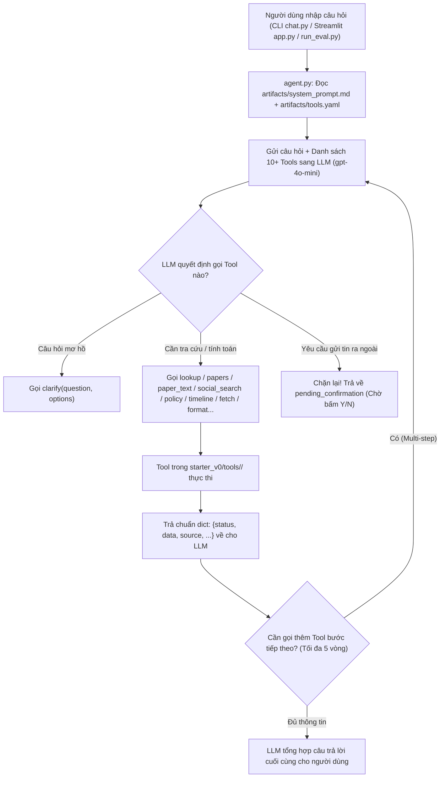

# HƯỚNG DẪN LUỒNG LÀM VIỆC & PHỐI HỢP NHÓM 5 NGƯỜI — LAB DAY 03

> **Học phần:** Prompt, Function Calling & Tool Design (MCP) — Research Agent Tool Eval  
> **Cấu hình đội hình:** 5 thành viên (4 Coder + 1 Thành viên Low-code)  
> **Mục tiêu:** Hoàn thành 100% yêu cầu bắt buộc + Đạt **Điểm cộng (Bonus)** với **Streamlit UI** và **4 Tools mới (> 3 tools)**.

---

## 1. BỐN QUY ĐỊNH BẮT BUỘC (TỪ SLIDE TIẾN ĐỘ LAB DAY 03)

1. **Làm theo nhóm — Nộp bài CÁ NHÂN trên LMS:**
   - Thảo luận, thiết kế, viết tool, test chéo và thuyết trình theo nhóm.
   - **Mỗi cá nhân phải tự nộp link repo của chính mình** lên hệ thống `aithucchien.vinuni.edu.vn`.
   - Trong repo phải có file `TEAM.md` ghi rõ tên nhóm và danh sách thành viên (Họ tên + MSSV + Vai trò).
2. **Quy chuẩn đặt tên Repository:**
   - **Repo cá nhân (dùng để nộp LMS):** `K5-L3-DAY03-HoVaTen-MSSV-ResearchAgentToolEval` (Ví dụ: `K5-L3-DAY03-PhamVietHung-2A202603370-ResearchAgentToolEval`).
   - **Repo nhóm (nếu tạo chung):** `K5-L3-DAY03-TenNhom-ResearchAgentToolEval`.
3. **Hạn nộp bài (Deadline):**
   - **Ca sáng (09:00–13:00) & Ca chiều (14:00–18:00):** Hạn cuối nộp LMS là **23:59 cùng ngày**.
   - **Ca tối (16:30–20:00):** Hạn cuối nộp LMS là **12:00 trưa hôm sau**.
   - **Hạn cứng trên lớp:** Phần A của `starter_v0/artifacts/REPORT.md` và **link Demo (Cloudflare Tunnel)** phải sẵn sàng trước giờ **Team Showdown** (`11:35` ca sáng / `16:35` ca chiều).
4. **Bảo mật & Điểm cộng (Bonus):**
   - **TUYỆT ĐỐI KHÔNG** commit file `.env` hoặc API key lên GitHub.
   - **Điều kiện Điểm cộng (Bonus):** Nhóm có **CẢ HAI**:
     1. Giao diện UI hoạt động (`starter_v0/app.py`)
     2. Viết **> 3 tools mới** (tức là tối thiểu **4 tools mới** ngoài 10 tools có sẵn).

---

## 2. KIẾN TRÚC & LUỒNG HOẠT ĐỘNG CỦA RESEARCH AGENT

### 2.1. Sơ đồ luồng xử lý 1 câu hỏi của người dùng



### 2.2. Tại sao bản gốc `v0` bị điểm thấp và nhóm phải làm gì?

| Vấn đề trong `starter_v0` (Bản gốc `v0`) | Hậu quả khi chạy chấm điểm | Giải pháp nhóm cần thực hiện |
| :--- | :--- | :--- |
| `artifacts/system_prompt.md` chỉ có đúng 2 câu sơ sài | LLM không biết khi nào phải hỏi lại (`clarify`), khi nào phải tra cứu hay từ chối câu hỏi ngoài lề | **TV1** viết lại `system_prompt.md` có quy tắc phân luồng rõ ràng |
| `artifacts/tools.yaml` có mô tả trùng lặp giữa `lookup`, `papers`, `social_search`, `fetch` | LLM chọn nhầm tool (ví dụ: dùng `lookup` để tìm bài báo học thuật thay vì `papers`) | **TV1** viết lại `description` trong `tools.yaml` theo cấu trúc: *Dùng khi nào / KHÔNG dùng khi nào* |
| `tools/social_search/__init__.py` chỉ cắt từ khóa bằng `.split()` | Không tìm được bài thảo luận liên quan nếu khác từ vựng | **TV2** nâng cấp thuật toán chấm điểm từ khóa / đồng nghĩa / lọc `platform`, `min_upvotes` |
| `tools/papers/__init__.py` chỉ đếm số từ trùng đơn giản | Xếp hạng sai bài báo quan trọng hoặc bỏ sót kết quả | **TV3** nâng cấp thuật toán chấm điểm (`title` weight cao hơn `abstract`, khớp cụm từ) |
| Chưa có UI, chưa đủ > 3 tools mới, `eval_group.json` & `REPORT.md` còn trống | Chưa đủ điều kiện nộp bài và chưa đạt Điểm cộng | **TV2 + TV3** viết 4 tools mới; **TV4** làm Streamlit UI; **TV5** viết `eval_group.json` & `REPORT.md` |

---

## 3. PHÂN CÔNG CHI TIẾT CHO 5 THÀNH VIÊN (4 CODER + 1 LOW-CODE)

> **Nguyên tắc vàng chống xung đột Git (Zero Merge Conflict):** Mỗi thành viên làm việc trên một nhóm file độc lập. Không ai sửa chồng lên file của người khác.

| Thành viên | Vai trò (Role) | File phụ trách chính (Độc quyền sửa) | Nhiệm vụ cốt lõi |
| :--- | :--- | :--- | :--- |
| **TV1 (Coder 1)** | **Prompt & Eval Lead** *(Nhóm trưởng kỹ thuật)* | `starter_v0/artifacts/system_prompt.md`<br>`starter_v0/artifacts/tools.yaml`<br>`starter_v0/artifacts/version_log.csv` | • Quản lý file `.env` và nhánh Git `main`.<br>• Chạy `run_eval.py` qua 4 mốc `v0 -> v1 -> v2 -> v3`.<br>• Tối ưu `system_prompt.md` và `tools.yaml` để kéo điểm `eval_base.json` từ ~35% lên >80%. |
| **TV2 (Coder 2)** | **Tool Engineer #1** *(Social & 2 Tools mới)* | `starter_v0/tools/social_search/__init__.py`<br>`starter_v0/tools/arxiv_search/` *(Mới)*<br>`starter_v0/tools/cite_validator/` *(Mới)* | • Cải tiến thuật toán tìm kiếm trong `social_search`.<br>• Viết **2 tool mới** (`arxiv_search`, `cite_validator`) kèm file `TOOL.md` đúng chuẩn contract (`status`, `data`, `source`). |
| **TV3 (Coder 3)** | **Tool Engineer #2 & Unit Test Lead** | `starter_v0/tools/papers/__init__.py`<br>`starter_v0/tools/acronym_expander/` *(Mới)*<br>`starter_v0/tools/reading_list/` *(Mới)*<br>`starter_v0/tests/test_tools_todo.py` | • Cải tiến thuật toán xếp hạng bài báo trong `papers`.<br>• Viết **2 tool mới** (`acronym_expander`, `reading_list`) kèm `TOOL.md` (cùng TV2凑 đủ **4 tools mới** để ăn Bonus).<br>• Viết đầy đủ các hàm unit test trong `tests/test_tools_todo.py`. |
| **TV4 (Coder 4)** | **UI & Integration Lead** *(Streamlit + Tunnel + Demo)* | `starter_v0/app.py` *(Mới)*<br>`starter_v0/artifacts/poster.html` *(Mới)*<br>`starter_v0/artifacts/chat_transcript.json` | • Xây dựng giao diện web `starter_v0/app.py` bằng Streamlit (có khung chat, hiển thị `tool_calls` trace, nút **Confirm / Cancel** khi gọi `send` qua Telegram).<br>• Mở public link bằng `cloudflared tunnel`.<br>• Chạy `chat.py` tối thiểu 3 lượt để xuất `chat_transcript.json`. |
| **TV5 (Low-code)** | **QA, Dataset & Report Lead** *(Kiểm thử & Báo cáo)* | `starter_v0/data/eval_group.json`<br>`starter_v0/artifacts/REPORT.md`<br>`TEAM.md` *(Mới)* | • Không cần code Python! Làm việc hoàn toàn trên Markdown và JSON.<br>• Thiết kế **10 test cases** trong `data/eval_group.json` (5 câu 1-tool + 5 câu multi-tool/clarify/edge case).<br>• Viết `REPORT.md` (Phần A trước Showdown, Phần B sau Showdown) và `TEAM.md`.<br>• Cầm kịch bản đi test chéo nhóm bạn trong giờ **Team Showdown**. |

---

## 4. LỊCH TRÌNH PHỐI HỢP THEO 7 MỐC THỜI GIAN TRÊN LỚP

### Mốc 1: Setup & Khởi động (`09:15–09:35` Ca sáng | `14:15–14:35` Ca chiều — *20 phút*)
- **TV1:** Tạo file `starter_v0/.env` từ `.env.example`, điền `OPENAI_API_KEY`, chạy lệnh kiểm tra:
  ```bash
  cd starter_v0
  python run_eval.py --preflight
  pytest
  ```
- **TV2 & TV3:** Đọc kỹ `starter_v0/tools/README.md` và `starter_v0/tests/test_tool_contract.py` để nắm rõ quy ước: mọi tool đều nhận `**kwargs` và trả về `dict` có chứa `status`, `data`, `source`.
- **TV4:** Cài đặt `streamlit` (`pip install streamlit`) và kiểm tra `cloudflared --version`.
- **TV5:** Tạo file `TEAM.md` ở thư mục gốc liệt kê đầy đủ 5 thành viên (Họ tên, MSSV, Vai trò, Link GitHub).

---

### Mốc 2: Chạy Baseline `v0` & Dựng khung UI (`09:35–10:10` | `14:35–15:10` — *35 phút*)
- **TV1:** Chạy điểm chuẩn ban đầu `v0` và tuyệt đối không sửa kết quả `v0`:
  ```bash
  python run_eval.py --tag v0 --notes "baseline"
  ```
  Sau đó mở kết quả xem những câu `cb_01..cb_20` nào bị trượt (`FAIL`) và báo cho nhóm.
- **TV2:** Bắt đầu nâng cấp `tools/social_search/__init__.py` và khởi tạo thư mục `tools/arxiv_search/`.
- **TV3:** Bắt đầu nâng cấp `tools/papers/__init__.py` và khởi tạo thư mục `tools/acronym_expander/`.
- **TV4:** Viết `starter_v0/app.py` (Streamlit UI) kết nối trực tiếp với hàm `run_turn()` và `execute_confirmed_send()` trong `agent.py`.
- **TV5:** Soạn 5 câu đầu tiên (`cg_01` đến `cg_05` — nhóm 1-tool) vào `starter_v0/data/eval_group.json`, ghi lại bảng điểm `v0` vào mục **A1** của `artifacts/REPORT.md`.

---

### Mốc 3: Tối ưu `v1` & Viết Tools Mới (`10:10–10:40` | `15:10–15:40` — *30 phút*)
- **TV1:** Sửa **1 biến số duy nhất** (ví dụ: viết lại `artifacts/tools.yaml` để phân biệt rõ 10 tools + sửa `system_prompt.md`), sau đó chạy `v1`:
  ```bash
  python run_eval.py --tag v1 --notes "rewrite tool descriptions and system prompt"
  ```
- **TV2:** Hoàn thành 2 tools mới (`arxiv_search`, `cite_validator`) kèm `TOOL.md` và chạy `pytest tests/test_tool_contract.py`.
- **TV3:** Hoàn thành 2 tools mới (`acronym_expander`, `reading_list`) kèm `TOOL.md` và chạy `pytest tests/test_tool_contract.py`.
- **TV4:** Hoàn thiện giao diện xác nhận gửi tin Telegram (`pending_confirmation`) trên `app.py` và test gửi thử tin nhắn.
- **TV5:** Hoàn thành 5 câu tiếp theo (`cg_06` đến `cg_10` — nhóm multi-step, clarify, hoặc gọi 4 tools mới của TV2/TV3) trong `data/eval_group.json`.

---

### Mốc 4: Ghép bộ Eval Nhóm + Chạy `v2` + Unit Tests (`10:40–11:10` | `15:40–16:10` — *30 phút*)
- **TV2 & TV3:** Push code 4 tools mới và phần nâng cấp `papers`, `social_search` lên repo. **TV3** hoàn thiện `tests/test_tools_todo.py` và chạy `pytest` xanh 100%.
- **TV1:** Pull code của TV2, TV3, TV5 về. Khai báo thêm 4 tools mới vào `artifacts/tools.yaml`. Chạy chấm điểm bản `v2` trên cả bộ đề gốc lẫn bộ đề nhóm:
  ```bash
  python run_eval.py --tag v2 --notes "improved social_search, papers and added 4 new tools"
  python run_eval.py --eval-file data/eval_group.json --tag v2_group --notes "group eval 10 cases"
  ```
- **TV4:** Tạo trang `starter_v0/artifacts/poster.html` tóm tắt kiến trúc và bảng điểm tăng trưởng từ `v0 -> v1 -> v2`.
- **TV5:** Cập nhật kết quả `v1`, `v2` và mô tả các tools mới vào mục **A1, A2, A3** trong `artifacts/REPORT.md`.

---

### Mốc 5: Chốt `REPORT.md` Phần A + Mở Link Demo (`11:10–11:35` | `16:10–16:35` — *25 phút - HẠN CỨNG*)
- **TV4:** Chạy Streamlit và mở cổng Cloudflare Tunnel:
  ```bash
  # Terminal 1:
  streamlit run app.py
  # Terminal 2:
  cloudflared tunnel --url http://localhost:8501
  ```
  Copy đường link `https://xxxx.trycloudflare.com` gửi cho cả nhóm và giảng viên.
- **TV5:** Rà soát lần cuối toàn bộ **Phần A (A1, A2, A3)** của `artifacts/REPORT.md` và push lên GitHub trước giờ Showdown.
- **TV1, TV2, TV3:** Kiểm tra thử link `trycloudflare.com` trên điện thoại/máy tính khác để đảm bảo hoạt động mượt mà.

---

### Mốc 6: Team Showdown — Đấu trường Test chéo (`11:35–12:30` | `16:35–17:30` — *55 phút*)
- **TV4 & TV1:** Trình bày Demo 3 phút trước lớp (show giao diện `app.py`, gọi thử các tool mới, demo tính năng chặn xác nhận trước khi gửi Telegram bằng tool `send`).
- **TV5:** Dùng bộ câu hỏi khó truy cập vào link `trycloudflare.com` của nhóm đối thủ để test chéo, ghi lại các tình huống đối thủ làm tốt hoặc bị lỗi.
- **TV2 & TV3:** Quan sát log trên máy TV4 khi nhóm bạn vào test chatbot của nhóm mình; ghi chú ngay các câu khiến chatbot chọn sai tool hoặc trả lời lỗi để sửa cho bản `v3`.

---

### Mốc 7: Chạy `v3` + Hoàn tất `REPORT.md` Phần B + Nộp LMS (`12:30–13:00` | `17:30–18:00` — *30 phút*)
- **TV1, TV2, TV3:** Tinh chỉnh lại `system_prompt.md`, `tools.yaml` hoặc logic tool để vá các lỗi phát hiện trong lúc Showdown, sau đó chạy lượt đánh giá cuối cùng `v3`:
  ```bash
  python run_eval.py --tag v3 --notes "post-showdown fixes"
  ```
- **TV4:** Chạy `python chat.py` và trò chuyện trực tiếp ít nhất **3 lượt (3 turns)** có kích hoạt tool call (và xác nhận `send`) để sinh file `starter_v0/artifacts/chat_transcript.json`.
- **TV5:** Điền hoàn chỉnh **Phần B (B1, B2, B3)** trong `starter_v0/artifacts/REPORT.md` (ghi lại những lỗi phát hiện ở Showdown và kết quả `v3`).
- **TẤT CẢ 5 THÀNH VIÊN:** Đồng bộ code hoàn chỉnh về **repo cá nhân của từng người**, kiểm tra `git status` đảm bảo không dính `.env`, push lên GitHub cá nhân và nộp link trên `aithucchien.vinuni.edu.vn`.

---

## 5. QUY TRÌNH GIT PHỐI HỢP & ĐỒNG BỘ REPO CÁ NHÂN

### 5.1. Khi làm việc chung trong buổi Lab
Mỗi thành viên chỉ `git add` đúng các file mình phụ trách:
```bash
# Ví dụ TV2 chỉ add các file của TV2:
git pull --rebase origin main
git add starter_v0/tools/social_search/ starter_v0/tools/arxiv_search/ starter_v0/tools/cite_validator/
git commit -m "feat(tools): upgrade social_search and add arxiv_search, cite_validator"
git push origin main
```

### 5.2. Khi nhân bản sang Repo cá nhân của từng thành viên để nộp LMS
Sau khi repo chung đã hoàn chỉnh ở Mốc 7, từng thành viên (TV1..TV5) đẩy code lên repo cá nhân mang tên `K5-L3-DAY03-HoVaTen-MSSV-ResearchAgentToolEval`:
```bash
git remote add my-personal https://github.com/<username>/K5-L3-DAY03-HoVaTen-MSSV-ResearchAgentToolEval.git
git push -u my-personal main
```

---

## 6. CHECKLIST KIỂM TRA TRƯỚC KHI BẤM NỘP BÀI TRÊN LMS

- [ ] `pytest` chạy **PASS 100%** (bao gồm `test_tool_contract.py` và `test_tools_todo.py`).
- [ ] `starter_v0/artifacts/version_log.csv` có tối thiểu **4 dòng**: `v0`, `v1`, `v2`, `v3` và điểm `v3 > v0`.
- [ ] `starter_v0/data/eval_group.json` có đủ **10 test cases** hợp lệ (`cg_01` đến `cg_10`).
- [ ] Có **4 tools mới** trong `starter_v0/tools/` kèm file `TOOL.md` cho mỗi tool (đạt điều kiện Bonus `> 3 tools`).
- [ ] Có file giao diện `starter_v0/app.py` hoạt động tốt (đạt điều kiện Bonus UI).
- [ ] `starter_v0/artifacts/chat_transcript.json` có ít nhất **3 lượt hội thoại thực tế**.
- [ ] `starter_v0/artifacts/REPORT.md` đã điền đầy đủ cả **Phần A (A1–A3)** và **Phần B (B1–B3)**.
- [ ] Có file `TEAM.md` ghi rõ danh sách 5 thành viên trong nhóm.
- [ ] **Không có file `.env`** hay API key nào bị đẩy lên GitHub (`git status --ignored`).
